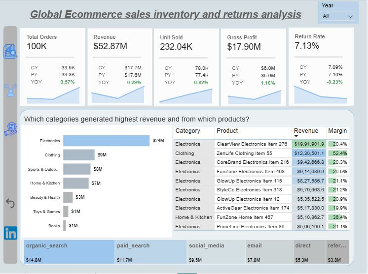
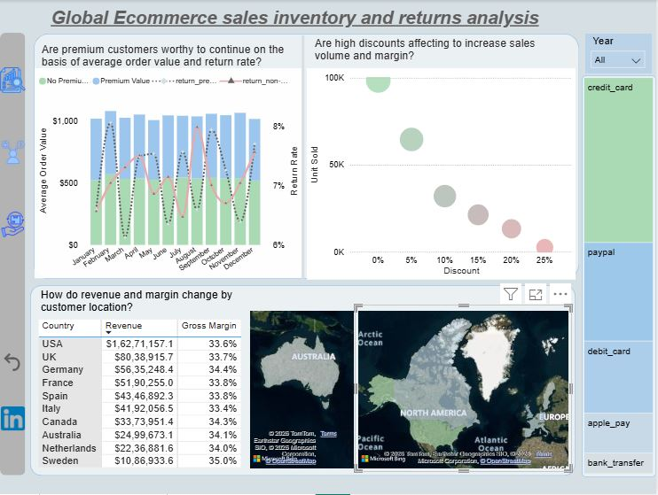
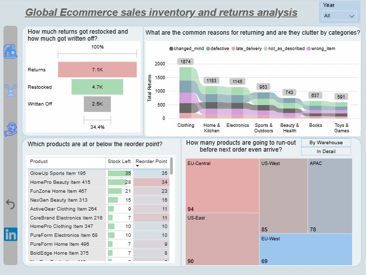

# Global-E-commerce-Sales-Inventory-Returns-Analysis
An interactive power bi report analyzing yearly sales, inventory, and returns performance to identify revenue drivers, customer purchasing patterns, return trends, and potential inventory stockout risks.

## Business Problem
The business operates across multiple products, customer segments, and warehouses, making it difficult to identify where performance is strong, where operational risks exist, and which areas require closer investigation.

### Business Questions Answered

•	How have revenue and return rates changed across countries and years?

•	Which products generate the highest revenue and gross margin, and how do their performances compare with their respective product categories?

•	How many returned products were written off instead of being returned to warehouses?

•	What are the most common return reasons, and how do they vary across product categories?

•	Which products are at risk of stockout before the next replenishment arrives, and which warehouses hold the highest number of at-risk products?

•	How does discounting affect sales volume and gross margin?

## Key findings

•	Generated approximately $53 million in revenue during the analysis period.

•	The return rate remained largely stable year over year, changing slightly from 7.10% to 7.09%.

•	Electronics was the highest-revenue category, generating approximately $24 million, while Clothing recorded the highest order volume.

•	Products sold with discounts in the 0–5% range accounted for a substantial share of sales volume while maintaining a stronger gross-margin contribution.

•	83.2% of products had fewer days of stock remaining than their expected replenishment lead time, indicating potential stockout risks. However, only 12% had already fallen below their reorder thresholds.

•	Approximately 34% of returned products were written off rather than returned to inventory. Write-off rates across different return reasons were relatively similar, ranging between 33% and 37%.

•	The USA and Europe were the largest contributors to total revenue, with the USA and UK leading among individual countries across the two years.

## Business Recommendations

**1. Inventory Replenishment** Review reorder points and supplier lead times based on current demand and stock coverage to reduce potential stockout risks.

**2. Return Write-off Investigation** Investigate why write-off rates remain similar across different return reasons and identify opportunities to recover products that could be returned to inventory.

## Tech Stack
I have used these tools or technologies to accomplish the report

**PostgreSQL** Data import, validation, and exploratory analysis 

**Power Bi Desktop** Data modelling, visualization and dashboard development

**Dax** Aggregation, Time Intelligence Measures and KPI Calculations

## Data Source

Global E-Commerce & Supply Chain Database, publicly shared dataset in Kaggle.

It contains approximately 100,000 transactions from 2022 to 2024, which includes customer demographics, products information, inventory levels, returns, transaction details, shipping locations, and order status.

## Project Workflow

**Understanding the business** Defined the business context, identified relevant analytical questions, and established the key metrics required to evaluate performance.

**SQL, Data Cleaning & Exploration** Imported fact and dimension tables into PostgreSQL, validated data quality, checked for nulls and inconsistencies, evaluated derived columns, and created structured views containing the required fields for analysis

**Power BI, Dashboard Design** Designed a three-page report with consistent navigation across sales, customer, inventory, and returns analysis.

## Dashboard Structure

**Performance Overview**
Revenue, transactions, gross profit, and return rate with year-over-year comparisons; top products and categories by revenue and margin; and revenue contribution by sales channel.

**Customer Behavior**
Average order value and return rates across premium and non-premium customers; discount levels versus sales volume and margin; revenue by customer location; and payment-type contribution to revenue.

**Inventory & Returns Risk**
Return reasons by product category; returned products resulting in write-offs; products at or below reorder thresholds; and products and warehouses exposed to stockout risk based on remaining stock versus replenishment lead time.

## Live Report
[Embedded Link](https://app.powerbi.com/reportEmbed?reportId=a223b72b-1434-4e94-827c-2c7618229219&autoAuth=true&ctid=56c1d497-700b-49cf-8f8d-3dd6b20d522f)

## Sample SQL: Creating structured views

CREATE VIEW dim_returns AS
 SELECT return_id,
      transaction_id,
	  customer_id,
	  product_id,
	  return_date,
	  reason,
	  refund_amount_usd,
	  restocked
 FROM returns;

CREATE VIEW dim_calendar AS
  SELECT DATE(GENERATE_SERIES(first_order_date :: DATE,
   						last_order_date :: DATE,
						'1 DAY' :: INTERVAL
    ))
  FROM(
        SELECT MAX(DATE) AS last_order_date,
		      MIN(DATE) AS first_order_date
	    FROM transactions
  )
